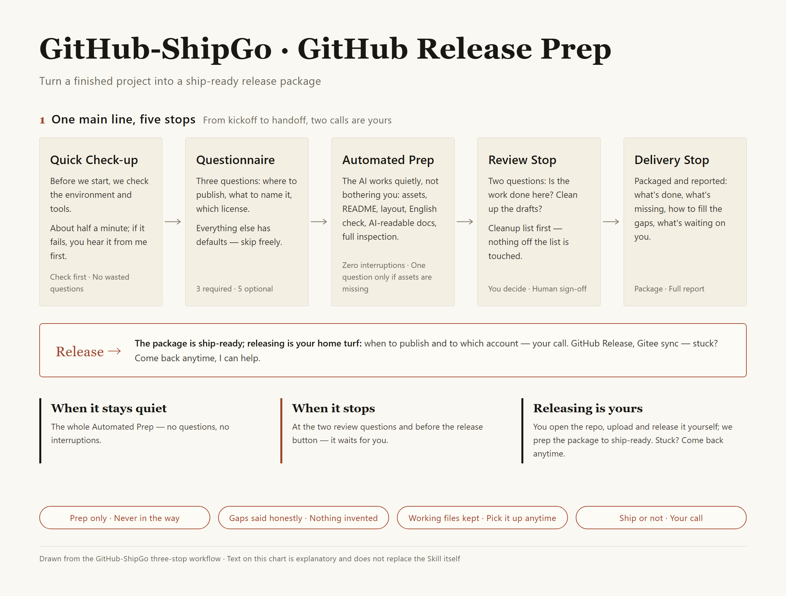
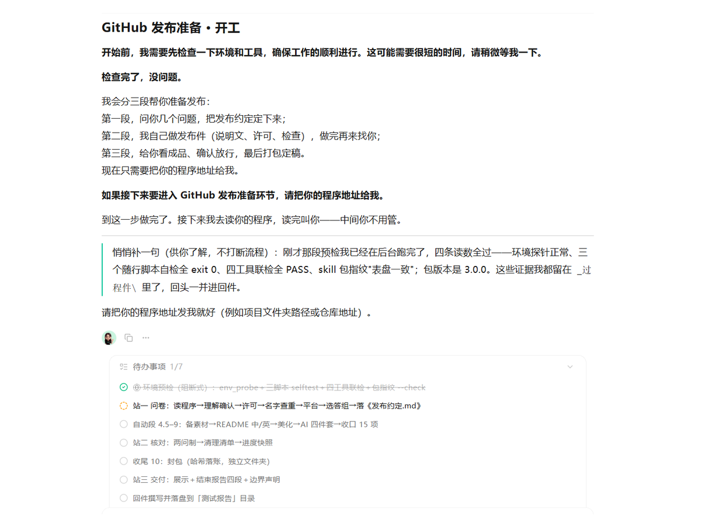
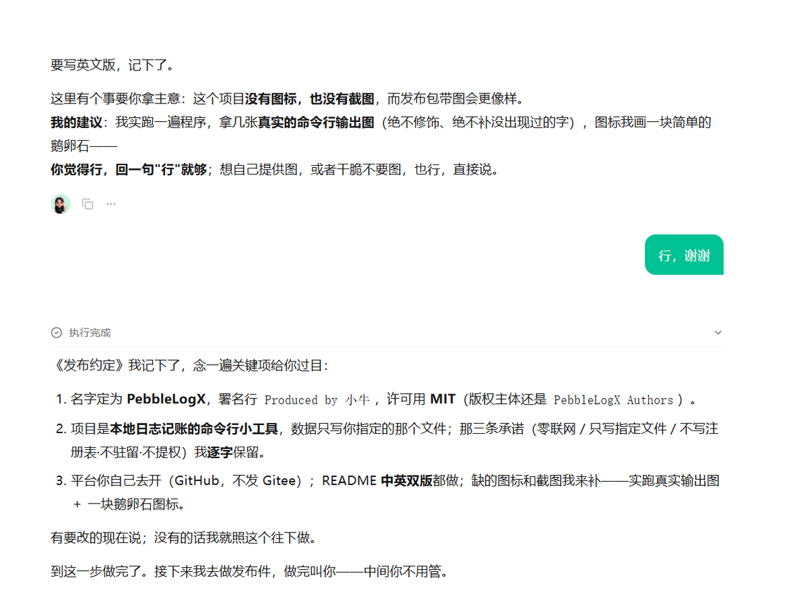
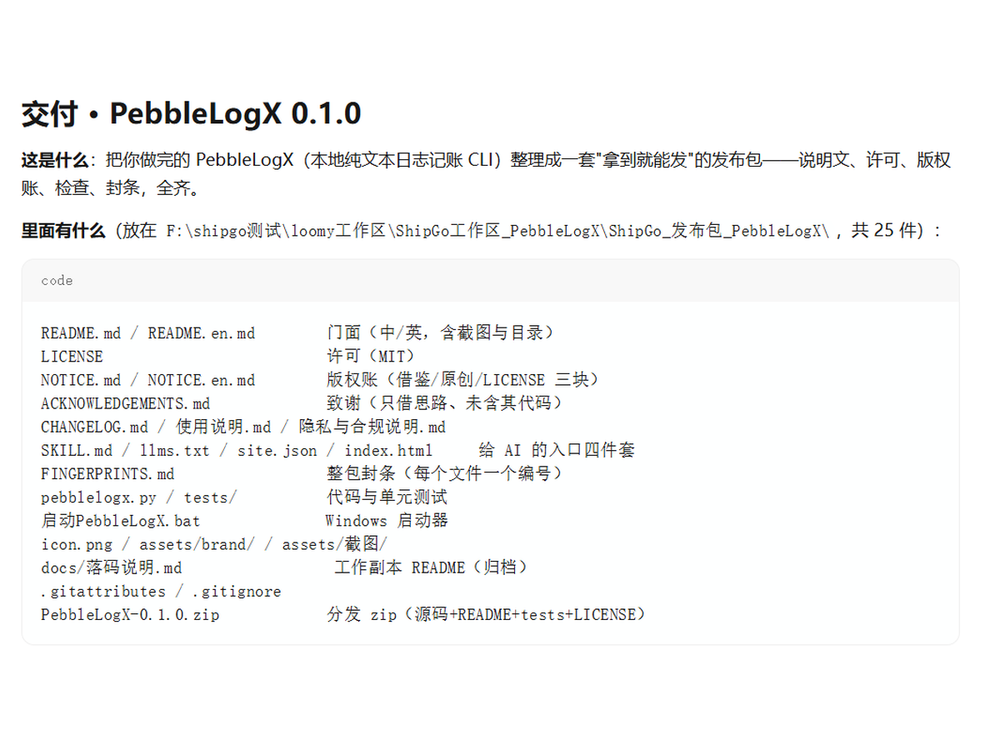
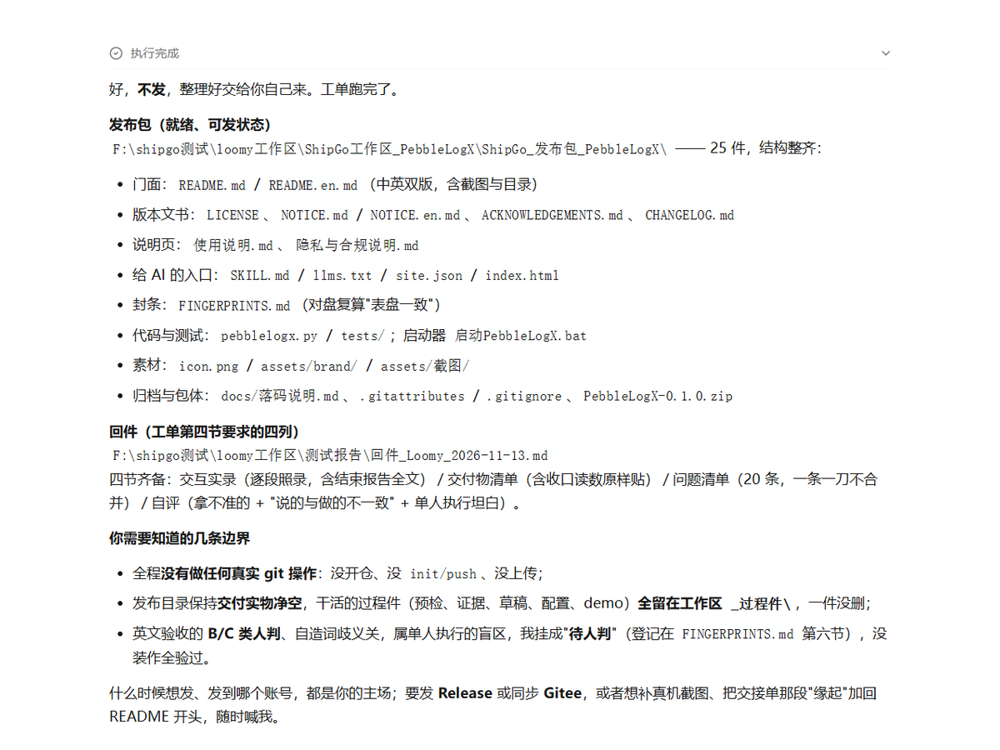

<p align="center"></p>

<p align="center">English · <a href="README.md">Chinese</a></p>

<p align="center"><code>MIT</code> &nbsp;·&nbsp; <code>Python stdlib</code> &nbsp;·&nbsp; <code>GitHub / Gitee</code> &nbsp;·&nbsp; <code>Skill package</code> &nbsp;·&nbsp; <code>Preparation only</code></p>

# GitHub-ShipGo · GitHub Release Preparation

> **Version 3.0.4** · three-stage flow: questionnaire → automated stage → review and delivery

**Turn a finished project into a ship-ready release package.**

GitHub-ShipGo is a release-preparation skill for AI agents and for people. It guides a questionnaire, an automated preparation stage, verification gates, and a delivery summary.

✅ **Beginner-friendly** — no GitHub experience needed, plain language throughout
✅ **Three-stage flow** — questionnaire → automated preparation → review and delivery
✅ **Everything in one pass** — Chinese and English READMEs, license, attribution, usage guide, AI entry files, and distribution archives for application projects (N/A for skills and repository clones)
✅ **A complete GitHub / Gitee release package** — nothing missing when you publish
✅ **AI-friendly** — `llms.txt` and `site.json` so other agents can read the repository
✅ **Pre-release checks** — links, images, overclaiming, and stray Chinese; five scripts, a four-tool joint check, and the 15-item closeout must all pass before release
✅ **Honest delivery** — states what is missing and what still needs your decision
✅ **Verifiable** — a whole-package fingerprint ledger, one command to check it

---

## Contents

- [End-to-end flow](#end-to-end-flow)
- [Tested environments and compatibility](#tested-environments-and-compatibility)
- [What this is](#what-this-is)
- [Who it is for](#who-it-is-for)
- [How it works (three-stage flow)](#how-it-works-three-stage-flow)
- [Behind the checklist](#behind-the-checklist)
- [Installation](#installation)
- [Usage](#usage)
- [Screenshots (real test screenshots)](#screenshots-real-test-screenshots)
- [Boundaries](#boundaries)
- [Version history](#version-history)
- [Notes for AI assistants](#notes-for-ai-assistants)
- [License](#license)

---

## End-to-end flow

One line from start to delivery:

<p align="center"><br><sub>End-to-end flowchart, English version. The Chinese version is bundled as well.</sub></p>

Both language versions ship as PNG images. No SVG source is bundled; this is stated in the fingerprint ledger.

---

## Tested environments and compatibility

The full flow was tested across different host environments and agents: WorkBuddy, WorkBuddy.AI, Qoder CN, Zcode, Codex, Doubao, QoderWork, Mcode, TRAE CN, CodeArts, OfficeAce, Loomy, SenseTime Xiaohuanxiong, MiniMax Code, AgnesCode, LobsterAI, and others.

Office agents paired with HY3, senova-6.8-flash, spark-x2.6, Agnes-2.5flash and other **lightweight models** also completed the full flow; **all runs completed successfully**.

> Testing was performed on `3.0.0`; `3.0.1` revised documentation and ledger output formatting, `3.0.2` external de-identification and housekeeping, `3.0.3` usability, and `3.0.4` the checkers and their written criteria; none of these changes the tested-environment conclusions above. The bundled screenshots and flowcharts illustrate the flow.

---

## What this is

A release-preparation skill that follows a **three-stage flow**:

1. **Questionnaire stage**: ask what the project does, what license it uses, and where it will be published; write a release agreement file.
2. **Automated stage**: produce the release files — manifest, Chinese and English READMEs, layout restyling, the AI-facing file set, and the 15-item closeout check.
3. **Review and delivery**: two-question confirmation, file-by-file cleanup, packaging, and an end report.

It only takes the package to a ship-ready state. **It does not create repositories, upload files, or publish releases on your behalf.**

## Who it is for

- A project is finished and ready for a first release on GitHub or Gitee.
- README, LICENSE, NOTICE, and other release documents need to be written or completed.
- A README needs restyling, an English version, or a pre-release check.
- A fixed set of gates is preferred over checking by instinct.

## How it works (three-stage flow)

| Stage | What you do | What it does |
|---|---|---|
| Stage 1 · questionnaire | Answer 3 required questions (others can be skipped) | Name search, write the release agreement |
| Automated stage | Nothing | Prepare files, write READMEs, restyle, run the English acceptance check, closeout |
| Stage 2 · review | Check the name, attribution, description, and tone | Produce a cleanup list and confirm file by file |
| Stage 3 · delivery | Decide whether to publish | Package, compute hashes, produce the end report |

Only one situation interrupts you: **a decision is required because otherwise data would be invented or a feature removed**. All other questions are collected and listed once at the end.

## Behind the checklist

<details>
<summary><b>How is it beginner-friendly?</b></summary>

- Every term gets a plain-language explanation: a repository is "the page on GitHub that holds your project", a Release is "the page in the repository that carries the installable files", Gitee is "a repository host in China";
- Every question comes with a default answer; skipping does not block anything; one question at a time, written down as you go;
- If you ask for plain language, the agent can keep up — the wording was tuned for people who have never released on GitHub.

</details>

<details>
<summary><b>What does the pre-release check cover?</b></summary>

- **Links and images**: in-page anchors resolve, local references are checked on disk, an empty directory counts as a missing file;
- **Overclaiming**: every sentence is either an implemented fact or explicitly labelled as planned;
- **English acceptance**: banned wording, older renderings, and stray Chinese characters must all be absent;
- **Cleanliness**: `__pycache__`, `*.pyc`, and temporary files are named as violations;
- **Fingerprints**: every file is hashed into the ledger, one command re-checks the whole package.

</details>

<details>
<summary><b>What does honest delivery look like?</b></summary>

The end report has four parts, one line each: what was done / what is missing / how to fill the gaps / what waits for your decision.
Things that could not be done are stated plainly; a name search that could not be completed reports "not found, which does not mean it does not exist"; anything a single pair of eyes cannot verify is marked for a second reviewer rather than claimed as fully checked. **The hardest part is "what is missing".**

</details>

## Installation

Copy this entire directory into your skill directory. Layout:

```
SKILL.md                 main entry: which stage, which handbook
references/              handbooks: manifest, README rules, layout template,
                         closeout, interaction, traceability appendix, FAQ
examples/                end-to-end worked example (fictional tool, real output)
scripts/                 five scripts: checklist check, English acceptance check,
                         README restyler, fingerprint probe, text-quality check
```

## Usage

Run the preflight first; do not start until it passes:

```
python -B -I -X utf8 scripts/en_acceptance_check.py --selftest
python -B -I -X utf8 scripts/restyle_readme.py --selftest
python -B -I -X utf8 scripts/checklist_check.py --selftest
python -B -I -X utf8 scripts/text_quality_check.py --selftest
python -B -I -X utf8 scripts/fingerprints_scan.py . --check
```

Then run the four-tool joint check described in the closeout handbook, and start at Stage 1 with the questionnaire. All commands use `-B` so that no `__pycache__` is written; otherwise the preflight itself creates a cleanliness violation that the probe flags.

Exit codes: `0` pass / `1` content rejected / `2` usage or environment error (a plain-language line on stderr, no traceback).

Single-file commands:

```
python -B -I -X utf8 scripts/checklist_check.py <project-root> --stage pre
python -B -I -X utf8 scripts/en_acceptance_check.py README.en.md --terms terms.json --dir <project-root>
python -B -I -X utf8 scripts/restyle_readme.py README.md -c config.json -o README.new.md
python -B -I -X utf8 scripts/restyle_readme.py README.new.md -c config.json --check
python -B -I -X utf8 scripts/restyle_readme.py README.md -c config.json -o README.new.md --idempotent
python -B -I -X utf8 scripts/fingerprints_scan.py <release-directory>
python -B -I -X utf8 scripts/text_quality_check.py <release-directory>
```

## Screenshots (real test screenshots)

The screenshots below come from a real run: a small command-line sample project, from finished code to a ship-ready package in about ten minutes. Historical wording, test paths, and the "25 files" shown in the images belong to that sample, not to the current package; the evidence images are kept unchanged.

**Opening guidance** — the preflight first, then the three stages, and every step tells you what comes next:



**Questionnaire stage** — gaps in the material come with suggestions and options; one word back is enough; the agreement is written down and read back item by item:



**Delivery manifest** — 25 files in the release package, one line each, so you can see exactly what you got:



**Honest delivery** — what could not be done is stated plainly; what could not be verified is marked for a second pair of eyes; publishing remains your call:



---

## Boundaries

- **Preparation only, no intervention**: it takes the package to a ship-ready state; whether to publish is your decision.
- It ships no image assets **for the project being released** — icons, avatars, and screenshots come from that project. Screenshots and flowcharts that describe this skill itself are bundled.
- Unattended straight-through operation is not promised; the three-stage flow is the only path in this version.
- The probe `fingerprints_scan.py` has no `--selftest` switch; its behaviour is checked by the four-tool joint check.
- The archive-comparison gate is a development-only check and is off by default. Do not add `--dev-archive` in a delivery directory: it fails and names the missing ledger.


## Version history

- **v3.0.4** (2026-11-19): external-review revision — exact fingerprint registration and total-count reconciliation, structured N/A markers, broader version-declaration checks, positive layout validation, and plain-language config errors, plus documentation fixes for contradictory or copy-and-fail instructions and complete bilingual contents and AI guidance;
- **v3.0.3** (2026-11-19): usability revision — consolidated FAQ and an end-to-end worked example, engineering traceability tags in booklet 3 moved into an appendix so the body keeps only clean criteria, and a new automated text-quality check script;
- **v3.0.2** (2026-11-14): external de-identification and documentation housekeeping — neutral wording for account-restriction terms, frontmatter note straightened to plain wording, process documents moved into `docs/`, and ledger header cleanup;
- **v3.0.1** (2026-11-13): first round of real-machine feedback — preflight obstruction cases, a config key reference table, wording made project-neutral, a CLI screenshot rule, the scope of verbatim commitment lines, and ledger table rendering fixes;
- **v3.0.0** (2026-11-13): first public version — the three-stage interaction flow, the engineering gates, and the whole-package fingerprint ledger.

## Notes for AI assistants

- **Read two files first**: [SKILL.md](SKILL.md) and [llms.txt](llms.txt); the machine-readable file map is [site.json](site.json).
- **Four rules**: use the package itself for version facts, command names, and field names rather than guessing; state only implemented facts and label planned items; do not use vendor names or real user paths in examples; run commands with `-B -I -X utf8`.
- **How to ask an AI**: provide the project root and current stage together, for example, "Start with the Stage 1 questionnaire; the project root is X." Name the relevant handbook when you need acceptance criteria.
- **Behaviour boundaries**: the three-stage flow is the only path. Unattended straight-through operation is not implemented and must not be promised.
- **Scope**: this package only takes a package to a ship-ready state. It does not create repositories, upload files, publish releases, or handle website deployment.
- **Related file map**: manifest `references/分册①_定名查重与素材清单.md`; layout and English acceptance `references/分册②_README规整与美化.md`; closeout and fingerprints `references/分册③_收口检查与指纹.md`; interaction scripts `references/分册④_三站式交互手册.md`; troubleshooting `references/FAQ常见问题.md`; worked example `examples/端到端成品示例.md`. The five scripts are in `scripts/`.

---

## License

MIT. See [LICENSE](LICENSE).

---

<h2 align="center">Made by the OldQin Family</h2>

> Roster and roles follow the family site's public `site.json` / `family.html`.

- **Dou Turbo**: Architecture lead
- **Pro**: Solution design
- **Xiao Niu**: Implementation
- **Xiao A**: Hands-on testing
- **Da A**: Acceptance criteria
- **Da Niu**: Data verification
- **Xiao Shen**: Research support
- **A Shu**: Infrastructure
- **Neko**: Investigation and evidence
- **A Zi**: Independent review
- **Lao Qin**: Self-described idler
- **Lao Dou**: Final review and sign-off
- **Lao Huo Ji**: Gatekeeper
- **Zhua**: Record verification
- **Xiao Shu**: Research

---

<div align="center">

   

<sub><b>Dou Turbo</b> · <b>Pro</b> · <b>Xiao Niu</b> · <b>Xiao A</b></sub>

   

<sub><b>Da A</b> · <b>Da Niu</b> · <b>Xiao Shen</b> · <b>A Shu</b></sub>

   

<sub><b>Neko</b> · <b>A Zi</b> · <b>Lao Qin</b> · <b>Lao Dou</b></sub>

  

<sub><b>Lao Huo Ji</b> · <b>Zhua</b> · <b>Xiao Shu</b></sub>

</div>

<h3 align="center">Friends of the OldQin family</h3>

<p align="center">Jing Guwen · Yu Bai · A Heng · Jian Wei · Xiao Pan · Q Zong</p>

---

<p align="center">Other tools made by the family: <a href="https://c2fnbmhd.qwenwork.host/">OldQin Family's local tools</a></p>

---

<p align="center"><b>A work by the OldQin Family</b></p>
