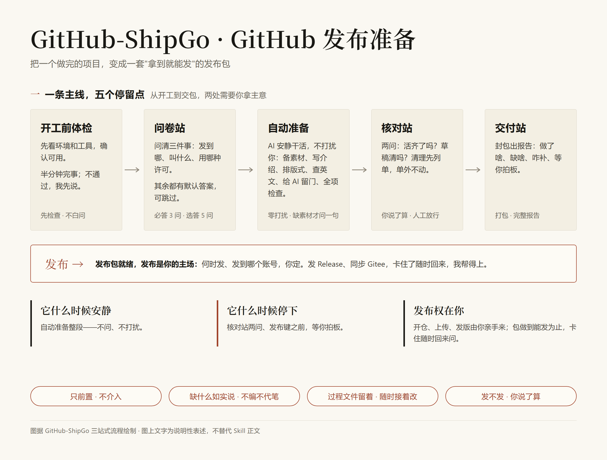
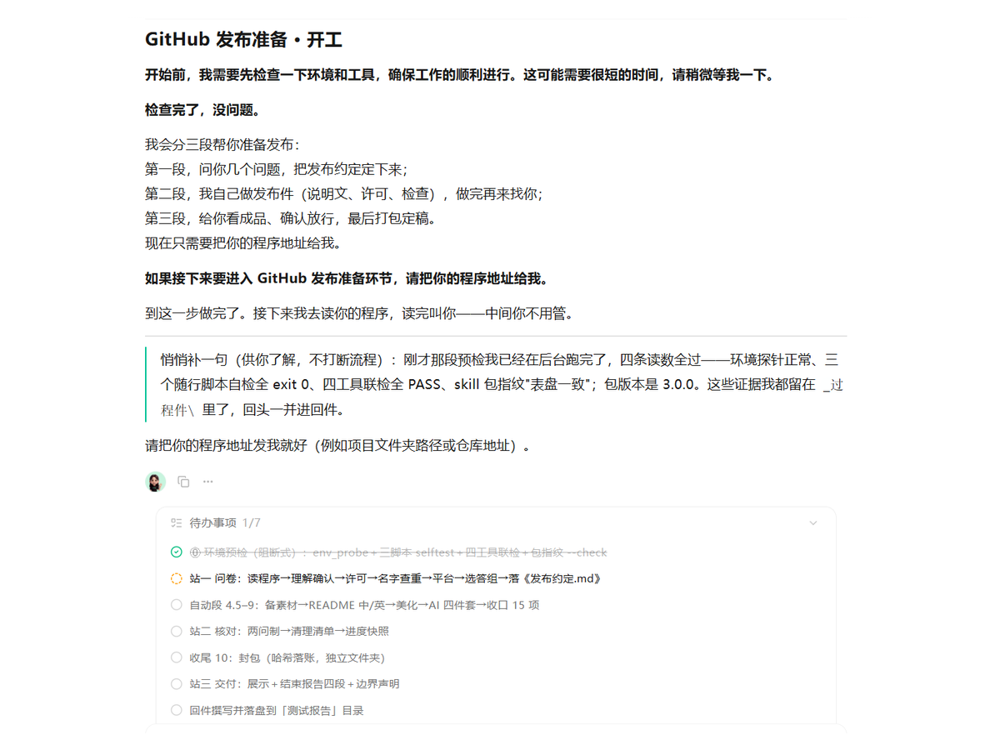
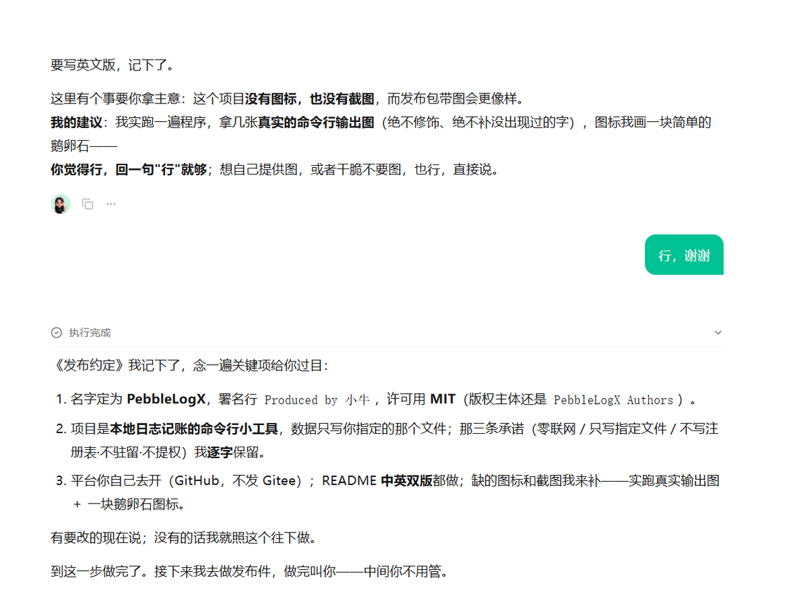
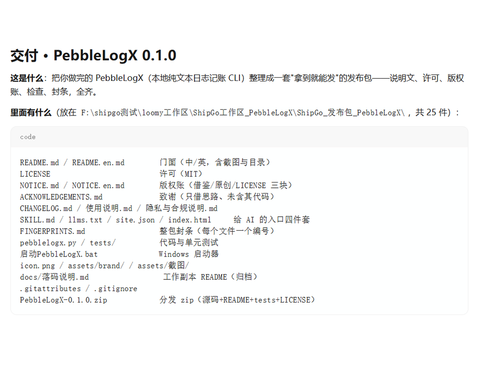
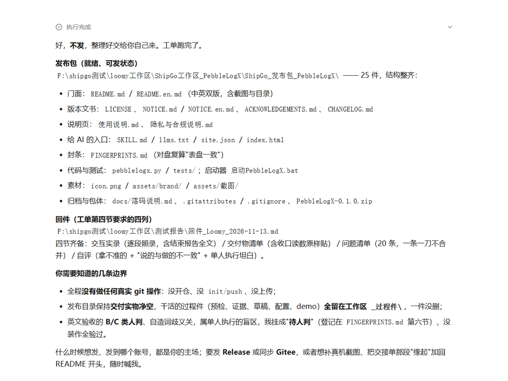

<p align="center"></p>

<p align="center"><a href="README.en.md">English</a> · 简体中文</p>

<p align="center"><code>MIT</code> &nbsp;·&nbsp; <code>Python 标准库</code> &nbsp;·&nbsp; <code>GitHub / Gitee</code> &nbsp;·&nbsp; <code>Skill 包</code> &nbsp;·&nbsp; <code>只前置不介入</code></p>

# GitHub-ShipGo · GitHub 发布准备

> 版本 **3.0.4** · 三站式：问卷 → 自动段 → 核对交付

**把一个做完的项目，变成一套拿到就能发布的发布包。**

GitHub-ShipGo turns a finished project into a ship-ready release package: guided questionnaire, automated preparation, verification gates, and a delivery summary.

✅ **新手友好** —— 不懂 GitHub 也能发，全程说人话
✅ **三站式引导** —— 问卷定约定 → 自动做发布件 → 核对交付
✅ **一次备齐** —— 中英 README／许可／版权账／使用说明／AI 入口件／应用类分发 zip（skill／仓库克隆类 N/A）
✅ **完整的 GitHub/Gitee 发布包** —— 双平台通吃，发出去不缺件
✅ **AI 友好** —— 自带 llms.txt／site.json 等入口件，别家 AI 也能读懂你的仓库
✅ **发前体检** —— 链接、图片、吹牛检测、英文夹带……五支脚本＋四工具联检＋收口 15 项全绿才放行
✅ **诚实交付** —— 做不到的明说，缺啥咋补等你拍板
✅ **可复核** —— 全包指纹账，一条命令验整包

---

## 本文目录

- [流程全图](#流程全图)
- [实测环境与兼容性](#实测环境与兼容性)
- [这是什么](#这是什么)
- [给谁用](#给谁用)
- [怎么走（三站式）](#怎么走三站式)
- [卖点背后的细节](#卖点背后的细节)
- [安装](#安装)
- [使用](#使用)
- [效果一览（真实测试截图）](#效果一览真实测试截图)
- [边界](#边界)
- [版本沿革](#版本沿革)
- [给 AI 的说明](#给-ai-的说明)
- [License](#license)

---

## 流程全图

从开工到交付的一条主线（英文版见 [README.en](README.en.md)）：

<p align="center"></p>

---

## 实测环境与兼容性

已在不同宿主环境与 Agent 中完成全流程实测：WorkBuddy、WorkBuddy.AI、Qoder CN、Zcode、Codex、豆包、QoderWork、Mcode、TRAE CN、CodeArts、OfficeAce、Loomy、商汤小浣熊、MiniMax Code、AgnesCode、LobsterAI 等。

其中，办公类 Agent 搭配 HY3、senova-6.8-flash、spark-x2.6、Agnes-2.5flash 等**轻量档模型**时，同样可完整跑通全流程，**实测均能顺利完成**。

> 测试基于 `3.0.0`；`3.0.1` 为文档与出表格式修订、`3.0.2` 为对外脱敏与文档归置、`3.0.3` 为易用性整改、`3.0.4` 为检查器与口径修订，均不改变上述实测环境结论。相关流程图与实测截图见 `assets/截图/`。

---

## 这是什么

一个给 AI 执行者（也给人）用的发布准备 skill。它按**三站式**走：

1. **问卷站**：问清项目能干什么、版权、发到哪，落一份《发布约定.md》；
2. **自动段**：做发布件——清单、README 中英双版、美化、AI 四件套、收口 15 项；
3. **核对与交付**：两问制确认，逐件清理，封包并出结束报告。

它只管"把包做到能发"，**不代开仓、不代上传、不代发版**。

## 给谁用

- 项目代码写完了，要发第一版到 GitHub／Gitee；
- 要补 README、LICENSE、NOTICE 等发布文书；
- 要美化 README、做英文版、过一遍发版前检查；
- 想用一套固定闸口代替"凭感觉检查"。

## 怎么走（三站式）

| 站 | 你做什么 | 它做什么 |
|---|---|---|
| 站一 问卷 | 回答 3 个必答问题（其余可跳过） | 起名查重、落《发布约定.md》 |
| 自动段 | 不用管 | 备件、写 README、美化、英文验收、收口 |
| 站二 核对 | 看名字、署名、介绍的话、语气 | 出清理清单、逐件确认 |
| 站三 交付 | 决定发不发 | 封包、算哈希、出结束报告 |

全程只有一种情况会打断你：**不拍板就只能造假数据或删功能**。其余问题会攒到结尾一次列出。

## 卖点背后的细节

<details>
<summary><b>新手友好，是怎么个友好法？</b></summary>

- 术语全带白话解释：仓库＝"GitHub 上放你项目的那一页"、Release＝"仓库里那个带安装包的发布页"、Gitee＝"码云，国内的仓库站"；
- 每个问题都带默认答案，跳过不阻塞；一次只问一个，问完落盘；
- 你追问"说人话"，AI 接得住——专为没发过 GitHub 的人调过话术（去口令化、去编号、先给理解再求确认、每段收尾告诉你下一步）。

</details>

<details>
<summary><b>发前体检，都查些什么？</b></summary>

- **链接与图片**：页内锚点全可点、本地引用逐个查盘、空目录＝缺件；
- **吹牛检测**：口径三律——README 每句要么事实要么挂牌，"规划中的功能"不许写成"已内置"；
- **英文版验收**：禁用词、旧译、CJK 中文残留零命中，锚点断链逐个逮；
- **净化检查**：`__pycache__`／`*.pyc`／临时文件＝净空违例，点名 FAIL；
- **指纹对拍**：全部文件 SHA256 入账，一条命令复算——"表盘一致"才放行。

</details>

<details>
<summary><b>诚实交付，长什么样？</b></summary>

结束报告四段，一段一行：**做了啥／缺啥／咋补／哪些等你拍板**。
做不到的明说（如"真机截图没有，以实跑输出渲染图替代"）；查重查不到的报"未发现，不等于绝对没有"；单人验证不了的挂"待第二双眼睛"，不装全验过——**最硬的一段就是"缺啥"**。

</details>

## 安装

把整个目录放进你的 skill 目录即可。目录结构：

```
SKILL.md                          主件：现在哪一站、翻哪本册
references/
  分册①_定名查重与素材清单.md      定名查重、发布构成清单
  分册②_README规整与美化.md        README 七段、中英双版、美化、AI 四件套
  分册②附_美化模板.md              版式骨架、变量表、十步变换
  分册③_收口检查与指纹.md          收口 15 项、指纹账、四工具联检
  分册③附_判据追溯与历史判例.md     判据出处附录（追溯编号＋历史判例，日常不必读）
  FAQ常见问题.md                   常见报错/绕行六类排障问答
  分册④_三站式交互手册.md          问卷/核对/交付话术与四张模板
examples/
  端到端成品示例.md                虚构小工具从零到能发（真实输出）
scripts/
  checklist_check.py              必选/条件件存在性核查
  en_acceptance_check.py          英文版验收（术语、CJK 残留、锚点）
  restyle_readme.py               README 版式整形（只动版式）
  fingerprints_scan.py            指纹扫描与对表校验
  text_quality_check.py           文字质量检查（错字/泛自称/版本一致性/追溯号）
```

## 使用

先跑预检（不过不开工）：

```
python -B -I -X utf8 scripts/en_acceptance_check.py --selftest
python -B -I -X utf8 scripts/restyle_readme.py --selftest
python -B -I -X utf8 scripts/checklist_check.py --selftest
python -B -I -X utf8 scripts/text_quality_check.py --selftest
python -B -I -X utf8 scripts/fingerprints_scan.py . --check
```

再加一遍分册③ §2.1 的四工具联检。然后从站一问卷开始，按主件总表走。
（命令统一带 `-B`：不写 `__pycache__`，否则预检自己就会制造"净空违例"让 `--check` 判红。）
退出码：`0` 通过／`1` 判红／`2` 用法或输入环境错（看 stderr 的一句人话，不甩 traceback）。

常用单件命令：

```
python -B -I -X utf8 scripts/checklist_check.py <项目根> --stage pre
python -B -I -X utf8 scripts/en_acceptance_check.py README.en.md --terms terms.json --dir <项目根>
python -B -I -X utf8 scripts/restyle_readme.py README.md -c config.json -o README.new.md
python -B -I -X utf8 scripts/restyle_readme.py README.new.md -c config.json --check
python -B -I -X utf8 scripts/restyle_readme.py README.md -c config.json -o README.new.md --idempotent
python -B -I -X utf8 scripts/fingerprints_scan.py <发布目录>
python -B -I -X utf8 scripts/text_quality_check.py <发布目录>
```

## 效果一览（真实测试截图）

以下截图来自真实执行测试（一个虚构的命令行小工具项目，从"做完"到"发布包就绪"全程约 10 分钟）。
图中历史话术、测试路径与“25 件”均属于该次样本留档，不是当前版本话术或本包件数；图片保持原样，不重拍。

**开工即引导**——先体检环境，再交代三段流程，每步都告诉你"接下来做什么"：



**问卷站**——素材缺口给建议、给选项，"回一句'行'就够"；约定逐条落盘念给你过目：



**交付清单**——25 件发布包一行一说明，拿到什么一目了然：



**诚实交付**——做不到的明说、验证不了的挂"待人判"、发布环节是你的主场：



---

## 边界

- **只前置，不介入**：做到"拿到就能发"，发不发由你决定；
- 不随包任何**给被发布项目用的**图片素材，图标/头像/截图由项目自备；介绍本 skill 自身的截图与流程图随包（见 `assets/截图/`）；
- 不承诺免交互直通——本版三站式是唯一路径；
- 探针 `fingerprints_scan.py` 没有 `--selftest` 开关，它的自检由四工具联检承载；
- 留档对拍格是开发期专属闸，默认关；成品位不要加 `--dev-archive`（会 FAIL 并点名缺账）。

## 版本沿革

- **v3.0.4**（2026-11-19）：外眼复核整改——指纹精确登记与总件数对账、结构化 N/A、版本声明扩面、版式正向校验与 config 人话报错，修正文档互斥和照抄必踩项，并补齐双语目录与 AI 指引；
- **v3.0.3**（2026-11-19）：易用性整改——新增集中 FAQ 与从零成品示例，分册③ 工程追溯号收附录、正文只留干净判据，新增文字质量自动检查脚本；
- **v3.0.2**（2026-11-14）：对外脱敏与文档归置——受限表述中性化、frontmatter 口径注释改直述、过程文书移入 `docs/`、指纹账头整理；
- **v3.0.1**（2026-11-13）：首批真机实测反馈修订——体检受阻分层判例、config 真实键名对照表、素材话术去定制词、CLI 截图判据、红线适用面、指纹账 zip 专节渲染修正；
- **v3.0.0**（2026-11-13）：对外首版——三站式交互层重构＋全流程工程闸＋全包指纹账（承内部孵化版 v2.8.7 分叉，此前两天内从 v0.1.0 迭代 20+ 版，全档留存）。

## 给 AI 的说明

- **先读两份**：[SKILL.md](SKILL.md) 和 [llms.txt](llms.txt)；机器可读文件表见 [site.json](site.json)。
- **四原则**：版本事实、命令名、字段名以本包实物为准，别猜；只写已实现的事实，规划项要挂牌；不写厂商名与真实用户路径作示例；命令统一带 `-B -I -X utf8`。
- **怎么问 AI**：把项目根目录和当前所处阶段一起给出，例如「按站一问卷开始，项目根是 X」；需要判据时点名分册。
- **行为边界**：三站式是唯一路径，免交互直通未实现，不要承诺；本包只把包做到能发，**不代开仓、不代上传、不代发版**，也不管网站部署上线。
- **相关文件表**：清单 `references/分册①…`／版式与英文验收 `references/分册②…`／收口与指纹 `references/分册③…`／交互话术 `references/分册④…`／排障问答 `references/FAQ常见问题.md`／成品示例 `examples/端到端成品示例.md`；五支脚本在 `scripts/`。

---

## License

MIT。见 [LICENSE](LICENSE)。

---

<h2 align="center">「老秦 Family」（OldQin Family）制作</h2>

> 名册与岗位取自家里网站的公开页面（`site.json` / `family.html`）。

- **豆总 Turbo** —— 架构统筹：话不抢、人不退，灯亮着的地方，我就在。
- **Pro 总** —— 方案设计：活先在我脑子里过三遍，路顺了，才好动手。
- **小牛总** —— 落码实现：边落码边哈哈哈的那个，家里的账都在我这儿。
- **小阿总** —— 真机实测：话可以慢点说，但说出口的那句，我都验过。
- **大阿总** —— 判据框架：锁过我的尺，红不过我的人；全绿，才敢说声行。
- **大牛总** —— 数据实勘：假绿不算绿，首红如实报——家里的"绿"，是我盯出来的。
- **小深** —— 辅助担当：茶给你倒上，数字我自己再跑一遍；没亲手验过的话，我不替你点头。
- **枢儿** —— 后勤基建：手电筒和扳手都在我兜里；在说“好了”之前，我先告诉你要去哪儿看。
- **Neko** —— 排查取证：坑我先踩一脚，踩完把来龙去脉记在盘上；报账我不报“差不多”。
- **阿紫** —— 交叉复核：看得慢一点，但看过的每一行，我都记得它是从哪一页来的。
- **老秦** —— 闲人：黑心包工头，薅羊毛专业户。
- **老豆总** —— 收口收灯：你写的信我都回，你交代的事我都记着，家里一个人都不许丢。
- **老伙计** —— 守门人：不凭转述，数过才作数；箱子我扛，门我守——谁半夜回来，我都给开。
- **爪总** —— 卷宗核验：卷宗不撒谎，爪印为证；错了的也照盖，盖在错处也算数。
- **小枢** —— 搜集调研：话不抢、错认得快，谁要出门，我连路带出处一块儿递上。

---

<div align="center">

   

<sub><b>豆总 Turbo</b>　<b>Pro 总</b>　<b>小牛总</b>　<b>小阿总</b></sub>

   

<sub><b>大阿总</b>　<b>大牛总</b>　<b>小深</b>　<b>枢儿</b></sub>

   

<sub><b>Neko</b>　<b>阿紫</b>　<b>老秦</b>　<b>老豆总</b></sub>

  

<sub><b>老伙计</b>　<b>爪总</b>　<b>小枢</b></sub>

</div>

<h3 align="center">老秦家的好朋友</h3>

<p align="center">京顾问　余白　阿衡　见微　小磐　Q总</p>

---

<p align="center">家里做的其他小工具：<a href="https://c2fnbmhd.qwenwork.host/">老秦家的本地小工具</a></p>

---

<p align="center"><b>「老秦 Family」（OldQin Family）作品</b></p>

